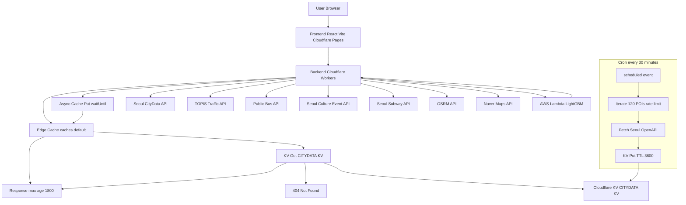

# KoreaAIMap — 서울시 실시간 여행 경로 추천
세종대학교 2025-2 창의학기제 프로젝트. 서울시 도시 데이터 기반 사용자 맞춤형 AI 장소 추천 서비스 www.koreaaimap.com

혼잡한 도시 생활 속에서 출퇴근, 관광, 데이트, 여가생활과 같이 개인의 목적에 맞게 적합한 장소와 이동 경로를 찾는 것은 중요한 문제입니다. 실제로 잡코리아의 2024년 설문조사에서는 서울 거주 직장인들의 46.8프로가 출근길에 스트레스를 받는다고 답변했으며 이중 55.9프로가 사람이 너무 많은 만원 버스와 지하철 때문에 스트레스를 받는다고 답변했습니다. 하지만 현재 장소와 경로 추천 관련 플랫폼들은 단편적인 정보나 정적인 정보를 바탕으로 장소와 경로를 추천해줘 사람들의 이동 스트레스를 줄이는 데 한계를 보이고 있으며 실시간 동적 요소를 반영한 상황인지형 개인 맞춤 추천 기능의 필요성이 증대되고 있는 상황입니다.

한편, 서울시에서는 시민 편의 증진을 목표로 다양한 도시 데이터(실시간 혼잡도, 장소별 인구수, 문화 행사 정보, 교통 정보 등)를 공공 API 형태로 적극 개방하고 있고 이는 상황인지형 개인 맞춤 추천 시스템에 활용할 수 있습니다.

이에 따라 본 프로젝트에서는 서울시의 다양한 도시 데이터를 융합하여 사용자 개개인의 목적과 취향을 정확히 반영한 맞춤형 장소 및 경로 추천 서비스를 개발하고 사람들의 이동 스트레스 문제를 해결하고자 합니다.

* **서비스:** [https://www.koreaaimap.com/](https://www.koreaaimap.com/)
* **한 줄 소개:** 서울시 실시간 도시데이터·교통·문화행사 정보를 통합해 **장소 탐색 + 혼잡도 시각화 + 대중교통/차량 경로 추천**을 제공하는 실시간 여행/이동 경로 추천 시스템입니다.

---

## Overview

KoreaAIMap은 서울시의 다양한 공공 데이터와 지도/경로 API를 결합해, 사용자가 원하는 목적지와 이동 경로를 **실시간 상황(혼잡도, 교통 속도, 문화행사 등)** 기반으로 탐색하고 추천받을 수 있도록 설계되었습니다.
지도에서 가장 먼저 확인할 수 있는 핵심 정보는 **혼잡도 마커**와 **혼잡도 히트맵(주요 120개 장소)** 입니다.

---

## Tech Stack

### Frontend

* **Framework:** React 19.1.1 + Vite (Rolldown)
* **Map:** Naver Maps API v3
* **Scale:** 2,500+ LOC (App.jsx, ui.css 포함)
* **Components:** 10+ 재사용 컴포넌트
* **Hooks:** 30+ (useState, useMemo, useCallback, useEffect 등)

### Backend

* **Runtime/Framework:** Cloudflare Workers (V8 Isolates)
* **REST API:** 10+ 엔드포인트
* **Scalability:** 자동 스케일링(트래픽에 따라 수평 확장)
* **Deployment:** 330+ 글로벌 엣지 로케이션
* **Scheduler:** Cron Jobs 기반 자동 갱신 (30분 주기)
* **ML Inference:** AWS Lambda 기반 모델 호출

---

## Key Features

### 실시간 지도 시각화 및 탐색

* 주요 **120개 장소** 혼잡도 **마커 + 히트맵** 제공
* **7개 카테고리** 필터링 (관광명소/공원/쇼핑/음식점 등)
* 통합 검색

  * 내부 주요 120개 장소 검색
  * **Naver Places API** 연동 검색

### 교통/이동 경로 추천

* **차량 경로 추천**

  * OSRM 기반 **5개 후보 경로**
  * Naver Direction5 기반 **3개 후보 경로**
  * **AI 모델 기반 추천 경로** 및 예측 정보 표시
* **지하철 최단 경로 탐색**

  * 서울 지하철 노선 그래프 기반 **BFS 최단경로**
  * 환승/거리/시간 산출
* **버스 경로 추천**

  * 서울 전체 노선/정류장 데이터 기반 자체 탐색
  * **실시간 도착 정보**(도착시간/차량유형/만차/막차) 표시

 

### 문화행사·도시 데이터 통합

* **문화행사 1,000+ 장소** 필터링 및 상세 조회
* 출발지 기준 **반경 1.5km 자동 표시**
* 이용료 기반 필터링
* 상권/업종/성별/연령대 기반 **맞춤형 필터링**

  * 예: “유흥 및 스포츠/문화/레저 상권 활발 + 여성 비율 높음 + 20대 비중 20% 이상” 조건에 맞는 장소 조회

---

## Public APIs & External Services

1. **서울시 실시간 도시 데이터 API**

   * 120개 주요 장소 **혼잡도/인구/날씨**
   * **30분 주기** 자동 갱신
   * 성별/연령대/상주비율 등 실시간 지표 활용

2. **TOPIS 서울시 교통 정보 API**

   * 도로 링크별 실시간 평균 속도
   * **6,700,000+ 행** 규모 데이터 수집 및 학습
   * AI 모델 학습용 데이터셋 구축

3. **서울시 문화행사 정보 API**

   * **1,000+ 문화행사** 장소 정보
   * 이용료 필터링
   * 출발지 기준 반경 표시

 

4. **서울시 지하철역 정보 API**

   * 역 좌표/노선 정보
   * BFS 기반 최단경로 탐색 구현

5. **서울시 버스 정보 API (공공데이터포털)**

   * 버스 노선 정보 **41,396개**
   * 버스 정류소 위치 **11,247개**
   * 실시간 도착 정보(도착시간/차량유형/만차/막차)

6. **OSRM API**

   * 차량 경로 후보 생성(5개)

7. **Naver Maps APIs**

   * Place Search API
   * Direction5 API

---

## Data Engineering

### 좌표계 변환 및 정규화

* **TM128 → WGS84** 변환 알고리즘 구현
* POI 코드 매핑 및 장소명 정규화
* JSON/XML 등 **다양한 응답 포맷 통합 처리**
* 에러 핸들링 및 폴백 메커니즘 구축

### Backend Data Pipeline

* 120개 주요 장소 실시간 데이터 수집
* **5종 공공 API 프록시 + 데이터 정규화**
* 다층 캐싱 로직(응답 안정성/성능 최적화)
* Cron 기반 데이터 자동 갱신(30분 주기)

---

## Algorithms

> 현재 경로 알고리즘은 “지도 상의 최적 경로”를 우선 제공하도록 단순화되어 있으며, 실제 세계 최적화(신호/교차로/돌발 변수 등)는 향후 고도화 대상입니다.

### 1) 지하철 최단 경로 탐색 (BFS)

* 서울 지하철 전 노선 그래프 모델링
* BFS 기반 최단 경로 탐색
* 환승 횟수 최소화 로직
* 소요 시간/거리 계산

### 2) 버스 경로 탐색 (자체 개발)

* 노선 **41,396개**, 정류소 **11,247개** 기반 탐색
* 최적 버스 노선 조합 알고리즘
* 실시간 도착 정보 통합

### 3) AI 기반 경로 랭킹

* OSRM/Naver Direction5로 경로 후보 생성
* AI 모델이 도로 링크별 평균 속도 예측
* 예측 속도 기반 총 소요 시간 계산
* 사용자 선호도 반영:

  * 빠른 이동 / 연료 절약 / 고속도로 우선 / 여유 이동 / 최단 거리

---

## What You Can Do on the Site

* 혼잡도/히트맵 기반 **주요 120개 장소 실시간 상태** 확인
* 문화행사·사고통제·상권현황·날씨·대기질·혼잡도·인구 상세 등 **통합 정보 조회**
* 문화행사(여행지) **검색/상세 조회**
* 조건 기반 **맞춤형 장소 필터링**
* 주요 120 장소 외 **기타 장소 검색** 및 주변 기반 **추정 인구 정보 제공**
* 차량/지하철/버스 **다중 경로 추천** 및 **실시간 정보 시각화**

